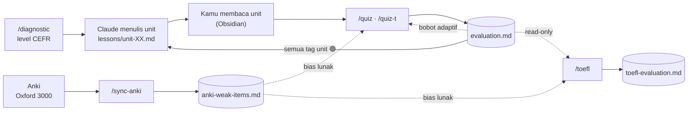
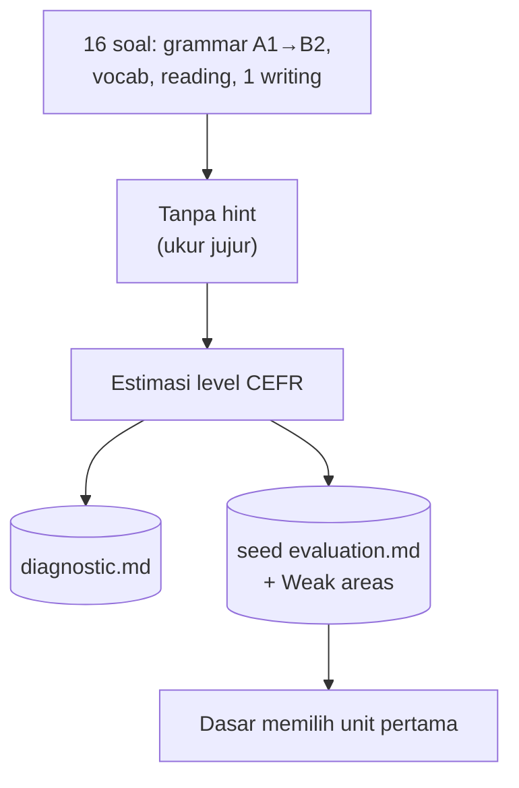
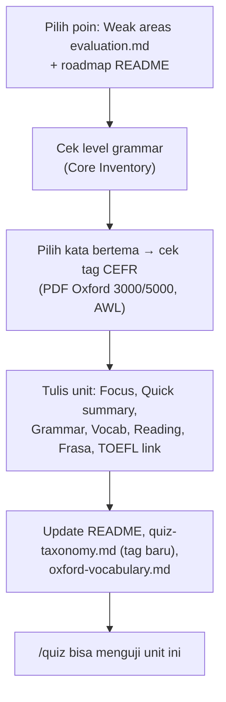
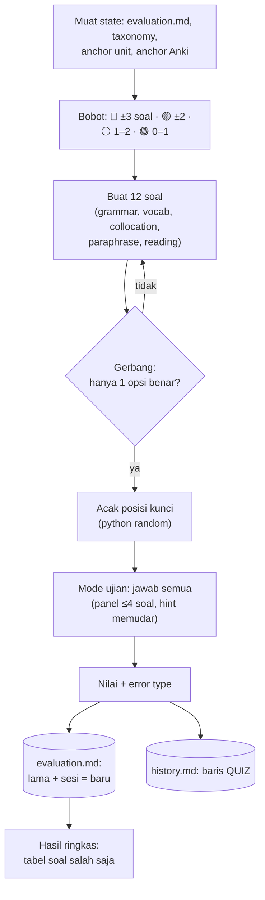
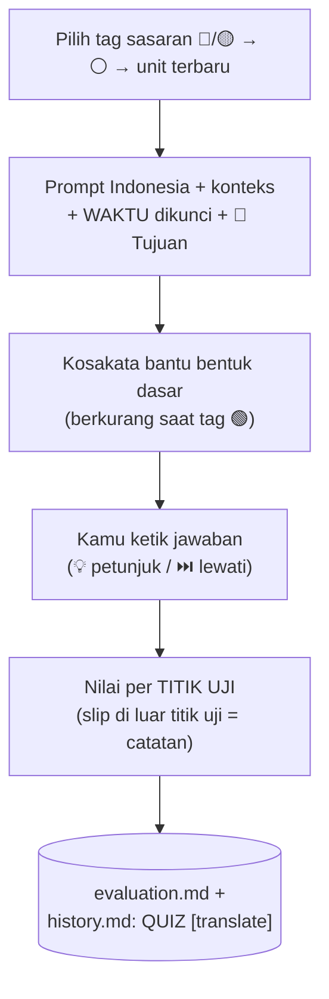
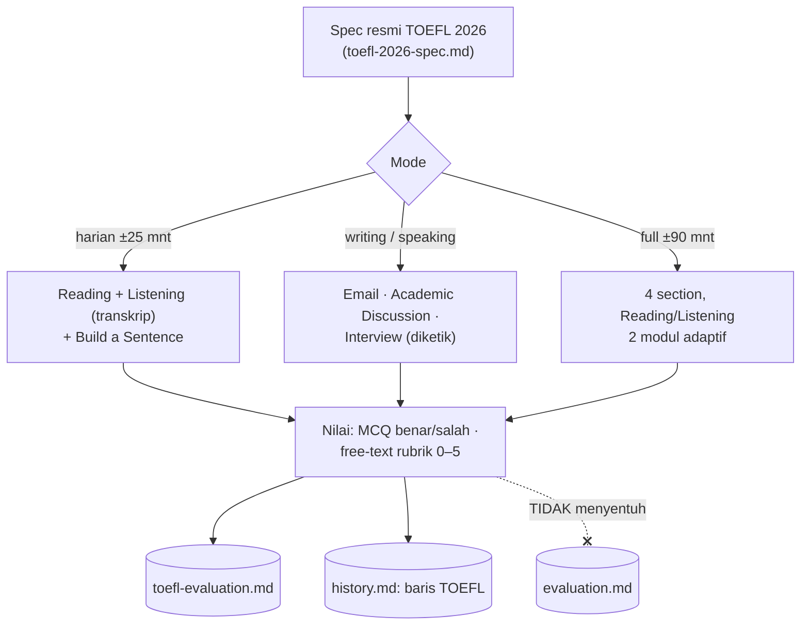
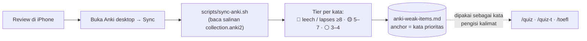
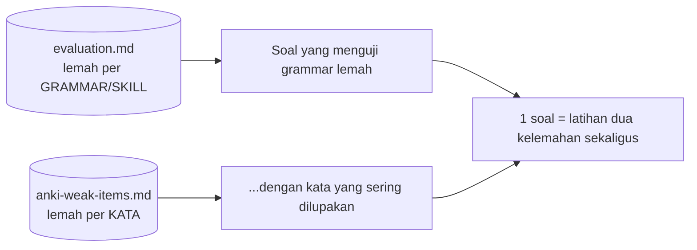

# Cara Kerja Knowledge Base — Flow & Logika

> Penjelasan **untuk manusia**: bagaimana KB ini bekerja dari ujung ke ujung. Diagram pakai
> Mermaid (otomatis ter-render di Obsidian). Detail teknis tetap di `CLAUDE.md` &
> `.claude/skills/*/SKILL.md`; dokumen ini peta besarnya.

## Ringkasan satu paragraf

KB ini membantu belajar English menuju **TOEFL iBT** untuk S2 di Institute of Science Tokyo,
dengan latihan **active recall** yang **adaptif** ke titik lemah. Alurnya: `/diagnostic`
menentukan level CEFR awal → Claude menulis **unit** materi di `lessons/` (source of truth) →
kamu membaca unit di Obsidian → tiap hari latihan lewat `/quiz` / `/quiz-t` → hasilnya **dicatat
balik** ke peta kelemahan → sesi berikutnya **otomatis condong** ke yang lemah. Anki (Oxford 3000)
menyumbang **sinyal kata yang sering kamu lupa**, dan `/toefl` mengukur kesiapan ujian dengan
format resmi TOEFL 2026.

> Proyek **sekunder** (fokus utama = Jepang) → semua dirancang **ringan**: sesi pendek, tanpa
> target padat.

## Tujuan

- 🎯 **Lancar berbahasa Inggris** (sehari-hari & akademik).
- 🎯 **Skor TOEFL iBT resmi** sesuai syarat program tujuan (patokan umum B2 = band 4–4.5).

## Peta komponen (siapa memegang apa)

| Komponen | Isi | Siapa menulis |
|---|---|---|
| `lessons/unit-XX.md` | materi per unit (grammar, vocab, reading, frasa, TOEFL link) — **source of truth** | Claude |
| `reference/` | pool vocab (Oxford/AWL), taxonomy tag, rubrik TOEFL | Claude |
| `reference/official-sources.md` · `toefl-2026-spec.md` | indeks sumber resmi · struktur & tabel band TOEFL 2026 (ETS) | Claude, dari dokumen resmi |
| `reference/sources/` | PDF resmi (Oxford, Core Inventory, ETS, …) — gitignored | unduhan |
| `progress/diagnostic.md` | level CEFR aktif | `/diagnostic` |
| `progress/evaluation.md` | kelemahan per **grammar/skill tag** | `/quiz`, `/quiz-t` |
| `progress/toefl-evaluation.md` | kelemahan per **task TOEFL** | `/toefl` |
| `progress/anki-weak-items.md` | kata Oxford yang sering dilupakan (AUTO-GENERATED) | `/sync-anki` |
| `progress/history.md` | log semua sesi (label `DIAG` / `QUIZ` / `TOEFL`) | semua skill |
| `docs/konvensi-unit.md` | aturan menulis/mengedit unit (anchor, cek referensi resmi) | Claude |
| `docs/perbaikan-kb.md` | log perbaikan aturan/skill (Problem → Fix) | Claude |

## Gambaran besar

## Alur 1 — Placement `/diagnostic` (sekali di awal, boleh diulang)

Hasil 2026-08-23: **A2** (vocab & reading B1–B2 kuat; grammar = fokus).

## Alur 1b — Menulis unit baru (Claude)

Detail: `docs/konvensi-unit.md`.

Level kata & grammar **wajib dari dokumen resmi**, bukan ingatan model (pelajaran 2026-10-29:
beberapa tag CEFR Unit 1 ternyata salah saat dicek ke PDF Oxford).

## Alur 2 — Latihan harian `/quiz` (loop adaptif = jantung sistem)

## Alur 2b — `/quiz-t` (terjemahan produksi Indonesia → English)

Sama dengan `/quiz translate`. Bedanya: kamu **mengetik** kalimat English sendiri (bukan klik),
4 soal, 1 soal per panel.

Kenapa waktu wajib dikunci: Bahasa Indonesia tidak punya tense — *"Saya tinggal di Bandung"* bisa
*I live / I lived / I have lived*.

## Alur 3 — Mock ujian `/toefl` (jalur terpisah)

- Persentase di sini **≠ band resmi 1–6** (ujian asli adaptif & dinilai ETS).
- Listening via transkrip → cenderung lebih mudah dari aslinya. *Listen and Repeat* di luar cakupan.

## Alur 4 — Sinyal Anki `/sync-anki`

Anki memilih **kata**, bukan grammar. Kata lemah diselipkan ke soal bila cocok secara alami —
bukan drill arti kata (itu tugas Anki).

## Logika inti: DUA sinyal kelemahan

## Cara skor & status dihitung (tanpa engine)

Proyek Jepang punya engine `kb.py`; di sini **Claude menghitung eksplisit** dari angka lama +
hasil sesi (tidak boleh mengarang angka).

| Tracker | Rumus | Status |
|---|---|---|
| `evaluation.md` (per tag / error / unit) | Correct += benar, Total += soal; Accuracy = Correct/Total | Total < 3 ⚪ · < 60% 🔴 · 60–79% 🟡 · ≥ 80% 🟢 |
| `toefl-evaluation.md` MCQ & build | sama seperti di atas, per task | sama |
| `toefl-evaluation.md` rubrik | Avg baru = (avg lama × n lama + skor sesi) ÷ n baru | n < 3 ⚪ · < 3 🔴 · 3–3.9 🟡 · ≥ 4 🟢 |

**Hint fading:** hint di opsi jawaban mengikuti status tag — 🔴/🟡/⚪ hint penuh → mendekati 🟢
hint netral → 🟢 tanpa hint (gaya ujian).

## Siklus belajar & ritme yang disarankan

| Kapan | Aktivitas |
|---|---|
| Setiap hari | Anki → (`/sync-anki` bila ada review) → `/quiz` atau `/quiz-t` |
| 1× seminggu | `/toefl` (harian, atau bergantian `writing` / `speaking`) |
| Semua tag satu unit 🟢 | minta Claude menulis unit berikutnya (roadmap di `README.md`) |
| Sesekali (mis. tiap 2–3 bulan) | ulang `/diagnostic` untuk cek kenaikan level |

## Status sekarang (per 2026-10-29)

| Bagian | Kondisi |
|---|---|
| Level aktif | **A2** (diagnostic 2026-08-23; vocab & reading B1–B2) |
| Unit | **1 unit** — Unit 1 (A2: present simple, present perfect for/since); tag CEFR & TOEFL link sudah disesuaikan referensi resmi |
| Skill | `/diagnostic` ✅ dipakai · `/quiz`, `/quiz-t`, `/toefl` ✅ ditulis, **belum pernah dijalankan** · `/sync-anki` ✅ jalan · `/lesson` ✅ ditulis (baca unit di chat) |
| Anki | deck `Oxford 3000 A1`: 525/929 kartu direview · 🔴1 🟡3 ⚪19 (exciting, describe, coat, fun, …) |
| TOEFL | format **2026** (band 1–6); tracker masih kosong |
| Berikutnya | tulis **Unit 2** (kandidat: past simple / first conditional — kelemahan 🔴 dari diagnostic) |

Riwayat perubahan sistem lengkap: `docs/perbaikan-kb.md`.

## Aturan main (selalu berlaku)

- Grammar hanya dari unit yang sudah ditulis; tag hanya dari `reference/quiz-taxonomy.md`.
- Level kata & grammar dicek ke referensi resmi (`reference/official-sources.md`).
- Mode ujian: jawab semua dulu, koreksi di akhir.
- Mengedit unit: jangan buang materi, laporkan tiap perubahan (konvensi: `docs/konvensi-unit.md`).
- Tiap perbaikan aturan/skill → 1 entri di `docs/perbaikan-kb.md`.

## Glosarium singkat

| Istilah | Arti |
|---|---|
| **CEFR** | skala level bahasa Eropa A1 (pemula) → C2 (mahir) |
| **Anchor** | ringkasan ±20 baris di awal file yang cukup dibaca skill (hemat token) |
| **Tag** | label poin yang diuji (mis. `A2-present-simple`, `RD-academic`) |
| **Lapses** | berapa kali kartu Anki "lupa" (ditekan Again setelah sempat hafal) |
| **Leech 🩸** | kartu Anki yang terlalu sering dilupakan (ditandai otomatis oleh Anki) |
| **Band** | skor TOEFL 2026 per section 1–6 (kenaikan 0,5) |
| **Titik uji** | satu poin grammar yang dinilai dalam soal produksi (`/quiz-t`) |
